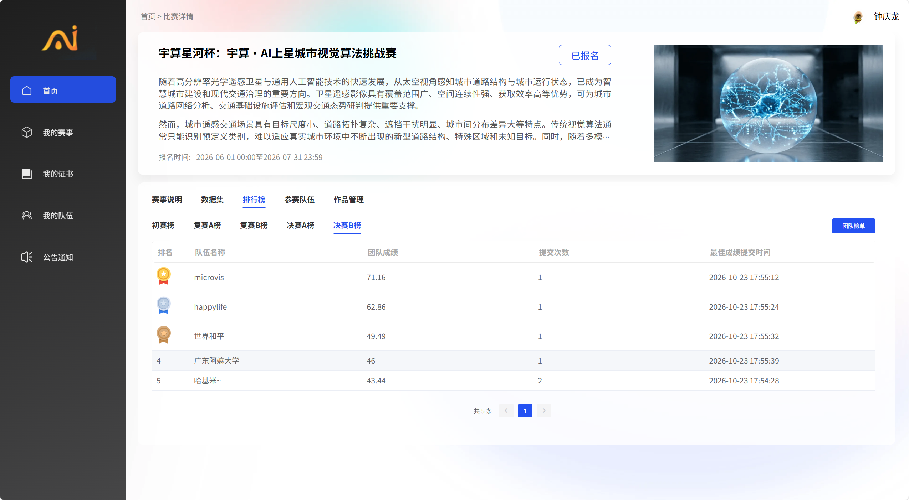

# 宇算·AI上星城市视觉算法挑战赛 · 星河杯 —— 决赛方案

本仓库开源我们在「宇算星杯：宇算·AI上星城市视觉算法挑战赛」（星河杯）决赛中使用的
**完整方案代码、训练流程与配置**。

| 项目 | 结果 |
|---|---|
| A 榜（任务能力） | **61.0933** |
| **决赛 B 榜（任务能力 80% + 星上推理速度 20%）** | **第 4 名 / 46.00 分** |
| 单一模型 | ✅ Qwen3-VL-8B-Instruct + LoRA + 内置 18 通道影像解码器，一个 checkpoint |
| 2000 题推理耗时（RTX 4090 48 GiB 实测） | **230–263 秒** |

### 决赛 B 榜最终排名（组委会公示，2026-10-23 截止）

| 排名 | 队伍 | 成绩 |
|---:|---|---:|
| 1 | microvis | 71.16 |
| 2 | happylife | 62.86 |
| 3 | 世界和平 | 49.49 |
| **4** | **广东阿嫲大学（本队）** | **46.00** |
| 5 | 哈基米~ | 43.44 |

> B 榜最终成绩 = 0.8 × 任务能力 + 0.2 × 星上推理速度，其中速度分为相对最快方案的比值。
> 我们 2000 题的本地实测是 230–263 秒；B 榜的 46.00 分说明速度项与任务项都还有提升空间。



---

## 1. 任务与评测方式

赛题要求：输入**一景遥感瓦片的光学 + SAR 影像**与一道中文问题，输出结构化 JSON 答案。
共 5 个题型，权重不同：

| 题型 | 占比 | 题目形式 | 评分 |
|---|---:|---|---|
| T1 | 25% | 图中种植面积最大的农作物是什么 | 类别准确率 |
| T2 | 15% | 图中包含哪些目标农作物 | 集合 F1 |
| T3 | 30% | 某作物的种植面积估算（km²） | 相对误差分段（5/10/20/30%） |
| T4 | 20% | 面积所在区间（多选一） | 选项准确率 |
| T5 | 10% | 两种作物面积比较（A/B/C） | 选项准确率 |

我们 A 榜的最高分项（对应候选 `candidate_v973_t2_06`，即 v973 + T2 阈值 0.6）：

| T1 | T2 | T3 | T4 | T5 | 加权 |
|---:|---:|---:|---:|---:|---:|
| 0.7120 | 0.7496 | **0.3167** | 0.7625 | 0.7300 | **61.0933** |

> 最终提交到 B 榜的候选是 `submission/candidate_v973_t3_scale_res500_t2_10.jsonl`
> （在 v973 基础上加 T3 作物系数校准、T2 阈值改为 1.0 km²、解码器 500 分辨率）。
> 两者权重相同、分项略有差异，上表是 A 榜实测最高的一组。

T3 是权重最高（30%）也是最能拉开差距的一项。

---

## 2. 术语、版号与数字含义

这一节先解释后面会反复出现的版号与数字，避免读起来一头雾水。

### 2.1 版号是什么：v500 / v972 / v973 是"运行编号"，不是步数

`v500`、`v972`、`v973` 是本队内部的**运行编号（run id）**，按实验先后递增。
**它们不是训练步数，也不是 epoch。** 一个 run = 一次完整训练任务，产出两样东西：

```
<run>/
├── best_task_heads.pt    ← 影像任务头：Dec4 解码器 + Season 季节头
├── best_task.json        ← 记录哪个 step 的本地评估最好，以及当时的指标
├── config.json           ← 该次训练的全部超参
└── best_task/            ← LoRA adapter（PEFT 格式）
```

run 内部按 `step` 存档（如 `ckpt-200_heads.pt`），**最终用的是 `best_task.json` 里记录的那个 step**，
不一定是最后一个 step。

各阶段实际关系：

| 版号 | 在本方案中的角色 | 步数 | micro / group | lr_head | 是否蒸馏 | 采用哪个 step |
|---|---|---:|---|---:|---|---|
| `v7_run`（V7） | 早期主训练阶段，奠定解码器与季节头 | 2000 | 3 / 8 | 2e-4 | ✅ 教师 `v2_run/area_teacher.npz` | — |
| `v500` | 更早的任务权重，作为 v972 的初始化 | — | — | — | — | — |
| `v972` | 从 `v500` 续训 | 1000 | 3 / 8 | 1e-4 | ❌ 无 | step 1000 |
| **`v973`** | **从 `v972` 续训，最终提交** | **400** | **32 / 32** | **5e-5** | ❌ 无 | **step 200** |

> **v973 只训 400 步，但选的是 step 200** —— 因为 step 200 的本地 task 最高，不是最后一个。

两个阶段的本地评估（`best_task.json` 原值）：

| 阶段 | step | task | T1 | T2 | T3 | T4 | T5 |
|---|---:|---:|---:|---:|---:|---:|---:|
| v972 | 1000 | 0.7449 | 0.8620 | 0.9031 | 0.5197 | 0.7600 | 0.8600 |
| **v973** | **200** | **0.7617** | **0.8680** | **0.9051** | **0.5363** | **0.7950** | **0.8900** |

⚠️ **这两行是"验证侧影像也参与了训练"的本地分，不是泛化分**，比官方分高很多（见第 3 节与第 6 节）。

### 2.2 `no_lm` / `freeze_season`：最后两阶段只训解码器

`v972`、`v973` 都设了 `no_lm: true` + `freeze_season: true`，含义是：

- **冻结 LoRA**（语言/视觉骨干不动）
- **冻结 Season 季节头**
- **只续训 Dec4 影像解码器**

所以 v972 与 v973 的 LoRA 文件 SHA-256 相同，复现最后阶段时直接复用 `weights/v973_adapter/`。

### 2.3 各数字的含义

| 数字 | 含义 |
|---|---|
| **18** | 输入通道数 = 12 光学 + 2 SAR + 1 光学有效性 + 1 SAR 有效性 + 1 SCL/9 + 1 云影指示。**测试时后两者置零**（测试集无 SCL） |
| **256** | 输入影像分辨率（256×256） |
| **16×16** | 视觉塔送给解码器的特征网格（256 ÷ patch 16 = 16），共 256 个空间格 |
| **500×500** | 解码器输出 / 分割监督分辨率（`DEC_RES=500`），掩码由 256 输入按 `[::2, ::2]` 得到 |

> `calib = 0.9357` 是 **patch_embed 卷积的初始化缩放系数**，不是面积系数——容易被误读。

| 符号 | 含义 |
|---|---|
| **七码 / `CODES7`** | `[1, 2, 3, 5, 24, 26, other]`，来自官方逐影像类别解释的 7 个类别码 |
| **五类作物** | 水稻、玉米、棉花、大豆、冬小麦（按这个顺序索引） |
| **`w_area` / `w_distill` / `w_season` / `w_cloud`** | 面积 / 蒸馏 / 季节 / 云影 四项损失的权重（1.0 / 0.15 / 0.2 / 0.1） |
| **`reweight`** | 面积损失里对稀疏作物的重加权强度（0.5） |
| **`micro` / `group`** | 单次前向的批大小 / 梯度累积后的等效更新批大小 |
| **2697 / 899** | 训练池组成：2697 张官方训练侧 + 899 张官方验证侧影像 |
| **T1–T5** | 五个题型，见第 1 节 |

### 2.4 文件名怎么读

以最终提交的 `candidate_v973_t3_scale_res500_t2_10.jsonl` 为例：

| 片段 | 含义 |
|---|---|
| `v973` | 使用哪个 checkpoint |
| `t3_scale` | 对 T3 的输出面积做了**逐作物系数校准**（系数见 `calibration.json`） |
| `res500` | 解码器按 500 分辨率输出 |
| `t2_10` | T2 存在性阈值取 **1.0 km²**（若为 `t2_06` 则是 0.6 km²） |

---

## 3. 方案概览

### 核心思路：一个模型、一个面积向量、五种题型统一派生

所有 5 个题型都从**同一个模型**产出的**同一个五维面积向量** `[水稻, 玉米, 棉花, 大豆, 冬小麦]`
派生，避免"按题型调不同模型"这种违规做法，也让面积估计能力成为唯一的瓶颈与优化对象。

```
18 通道缓存 (18×256×256)
        │
        ├──► Qwen3-VL-8B 视觉塔 ──► 16×16×1152 特征图 ──┐
        │        (LoRA 微调)                            │
        │                                                ▼
        └──────────────────────────────────► Dec4 解码器 (U-Net)
                                              ├─ 卷积主干跑在原始 18 通道上
                                              └─ 视觉特征在最粗层加性注入
                                                        │
                                      ┌─────────────────┴─────────────────┐
                                      ▼                                   ▼
                            500×500 七码分割图                    Season 头 (2 类)
                            code_areas() → 7 码面积                    │
                                      │                                 │
                                      ▼                                 ▼
                            official_areas() ──────────► 五维作物面积向量
                                                                │
                          ┌──────────┬──────────┬───────────────┼──────────┬──────────┐
                          ▼          ▼          ▼               ▼          ▼          ▼
                     T1 argmax   T2 ≥1.0km²   T3 数值+系数    T4 区间匹配   T5 比较
```

### 七码 → 五类的映射

分割监督用 7 个码（`CODES7 = [1, 2, 3, 5, 24, 26, other]`，来自官方逐影像类别解释），
再由 season 头给出的麦季概率 `p` 折算成 5 类作物面积：

```python
official_areas(c, s_logits) = [c[2], c[0], c[1],
                               c[3] + (1 - p) * c[5],
                               p * (c[4] + c[5])]
```

其中 `c = code_areas(logits, valid) = softmax(logits).mean((2,3)) * 100`（km²）。

### 三个关键设计

1. **解码器是面积精度的主要承载者。** `Dec4` 的卷积主干跑在**原始 18 通道影像**上
   （256 → 128 → 64 → 32），视觉塔的 16×16 语义特征只在**最粗层做一次加性注入**。
   我们做过消融：把视觉特征置零，解码器仍能拿到 T3 = 0.16~0.22；换成其他编码器
   （Prithvi-600M 冻结、甚至 v973 自己的特征冻结）都停在 0.24~0.32，而联合训练是 0.536。
   **结论：能不能"特征与解码器联合训练"比换多大的编码器重要得多。**

2. **500×500 掩码监督。** 原始 256 输入的掩码按 `[::2, ::2]` 保留到 500×500 作为分割监督，
   连续面积标签仍按原始分辨率计算。分辨率越高，T3 的相对误差越小。

3. **SCL 缺失路径固定。** 测试集影像没有 SCL，因此正式入口统一把两个 SCL 通道
   以训练均值补齐（归一化后恰为 0），**不读取测试侧 SCL**，保证训练/推理条件一致。

### 训练链

```
早期阶段：V7 / v500 系列（奠定解码器与季节头；v7_run 共 2000 steps）
  └─► v972  从 v500 续训 1000 steps
        └─► v973  从 v972 续训 400 steps   ← 取 step 200 的 best task
```

> 版号不是步数，各阶段的步数、批大小、学习率与是否蒸馏见 **§2.1**。

`v972` / `v973` 均使用 `no_lm` + `freeze_season`：**冻结 LoRA 与季节头，只续训影像解码器**。
最终训练阶段配置（见 `B榜材料/training/original/v973/config.json`）：

| 参数 | 值 |
|---|---|
| steps | 400（选用 step 200） |
| group / micro | 32 / 32 |
| lr_head | 5e-5 |
| reweight | 0.5 |
| 输入分辨率 | 256 |
| `DEC_RES`（解码器输出） | 500 |
| 训练池 | 2697 张官方训练侧 + 899 张官方验证侧影像 |

> ⚠️ 如实说明：该阶段评估沿用了**参与训练的验证侧集合**，历史 task 数值不是严格独立的
> 泛化分数。后来我们用官方留出影像做过校准，并发现验证集对官方 T3 存在系统性高估。

### 后处理校准

`calibration.json` 保存了在官方训练池之外影像上拟合出的**固定作物系数**与 T2 阈值：

```json
{ "t2_crop_scales": {"水稻":1.2,"玉米":0.925,"棉花":1.225,"大豆":1.1,"冬小麦":0.95},
  "t3_crop_scales": {"水稻":1.025,"玉米":0.975,"棉花":1.15,"大豆":1.0,"冬小麦":1.025},
  "t2_threshold_km2": 1.0 }
```

这些系数**不按 B 榜数据重新拟合**。最后提交的候选是
`submission/candidate_v973_t3_scale_res500_t2_10.jsonl`
（T3 作物系数校准 + T2 阈值 1.0 + 解码器 500 分辨率）。

---

## 4. 仓库结构

```
.
├── README.md                          ← 本文件
├── submission/
│   └── candidate_v973_t3_scale_res500_t2_10.jsonl   ← 最终 B 榜提交答案（2000 题）
└── B榜材料/                            ← 提交给组委会的完整材料包（原样保留）
    ├── README.md                      ← 官方提交说明（安装、推理、资源清单）
    ├── calibration.json               ← 固定校准系数与阈值
    ├── requirements.txt
    ├── run_inference.sh               ← 可移植推理入口
    ├── SHA256SUMS                     ← 完整提交包的校验和
    ├── inference/                     ← 实际推理代码
    │   ├── infer_v973_core.py
    │   ├── make_submission.py
    │   ├── v2_lib.py                  ← 码表 / 面积公式 / patchify
    │   ├── v4_lib.py                  ← Dec4 解码器 / 统一模型
    │   └── train_area_qa_patch_v2.py  ← 数据预处理
    ├── training/                      ← 训练与校准
    │   ├── README.md                  ← 训练流程说明
    │   ├── prepare_data.py            ← 数据预处理入口
    │   ├── train_stage.py             ← 最终阶段训练入口
    │   ├── calibrate_v973_unseen_t2.py / _t3.py
    │   ├── make_v973_*candidate.py    ← 候选生成
    │   ├── initial/                   ← 最后阶段所需的 v972 初始化任务头
    │   └── original/                  ← 实际预处理/训练实现与各阶段配置
    ├── external_resources/            ← 第三方来源、版本、许可证
    └── dependencies/install_offline.sh
```

### 关于未包含的权重与运行时

按约定，**所有权重文件均不入库**（本队训练出的 LoRA / 任务头也不推送，它们只随提交给组委会的
`B榜材料` 压缩包交付）。以下内容需要自行获取或从提交包中取用：

| 内容 | 大小 | 获取方式 |
|---|---:|---|
| Qwen3-VL-8B-Instruct 基座权重 | ~17.5 GB | ModelScope `Qwen/Qwen3-VL-8B-Instruct`，revision `1610d9f98460d59272cd9963efdf92f0cd3c8dc9`；逐文件 SHA-256 见 `B榜材料/external_resources/resources.json` |
| `weights/v973_adapter/`（本队 LoRA） | ~83 MB | 随组委会提交包提供 |
| `weights/v973/`（本队影像任务头） | ~43 MB | 随组委会提交包提供 |
| `training/initial/best_task_heads.pt`（v972 初始化任务头） | ~43 MB | 随组委会提交包提供 |
| ARM64 Python 运行时 + Torch/应用 wheel | ~780 MB | 需按 `B榜材料/requirements.txt` 在目标平台离线安装；原始来源见 `resources.json` |

因此本仓库可以直接阅读、评审和复现**代码与训练流程**；要真正跑通推理或训练，
需要把上表中的权重按原路径补齐。

基座上游许可为 **Apache-2.0**，全文见 `B榜材料/external_resources/Qwen-LICENSE.txt`。

---

## 5. 如何复现

### 4.1 准备环境

```bash
# 目标平台：Linux ARM64 (Jetson AGX Thor/T5000) + CUDA 13.0，或任意 x86_64 + CUDA 的 GPU 机器
cd B榜材料
bash dependencies/install_offline.sh      # 使用随包 wheel，--no-index --no-deps，不联网
```

### 4.2 推理（2000 题）

```bash
bash run_inference.sh \
  --input    /path/to/qa_test.jsonl \
  --data-root /path/to/test_data \
  --model    /path/to/weights \      # 含 base/ v973/ v973_adapter/
  --output   /path/to/result.jsonl
```

入口关闭 Hugging Face 在线下载，只读本地资源；输出 UTF-8 JSONL，保持题目顺序，
`answer` 为 JSON 对象字符串。**每批 8 题，输入 256，解码器 500，最多生成 48 tokens。**

### 4.3 复现训练

```bash
# 1) 数据预处理（生成 18 通道缓存、七码监督、500×500 掩码监督）
python3 training/prepare_data.py --work-root /path/to/official_work

# 2) 最后阶段训练（v973）
python3 training/train_stage.py \
  --work-root /path/to/official_work \
  --model     /path/to/weights \
  --output    /path/to/reproduced_v973
```

预处理依次完成：

1. `train_area_qa_patch_v2.py` — 光学 `/10000`、SAR `(x+35)/40`，附加光学/SAR 有效性，
   面积依据官方 MASK + 有效像元 + 逐影像类别解释计算 → 16 通道 256×256 缓存
2. `build_code_cache.py` — 七码码级监督、五类面积、训练季标注
3. `build_scl_cache.py` — 追加 SCL/9 与云影指示 → **18 通道**缓存
4. `build_y7_500.py` — 掩码按 `[::2, ::2]` → 500×500 分割监督

---

## 6. 我们试过但没走通的路线（供后来者避坑）

这一节是实测结论，不是猜测。**所有重训方案的官方分都低于 61.0933。**

| 尝试 | 本地 T3（600 道真题口径） | 结论 |
|---|---:|---|
| **v973（联合训练，基线）** | **0.536** | 最好 |
| 换编码器：Prithvi-EO-2.0-600M（冻结） | 0.319 | 不如基线 |
| 冻结 v973 自己的视觉特征 | 0.244 | **连自己的特征冻结后都更差** |
| 全零特征（对照） | 0.162 | 解码器自身仍有贡献 |
| 空间 UNet 读出 | 0.171 | 无改善 |
| cross-attention 读出 | 0.120 | 无改善 |
| **解冻编码器后 4 层** | **0.076** | **解冻反而更差** |
| InternVL3.5-14B（更大） | 面积路径 T1/T2/T3 ≈ 0 | 已放弃 |
| Constant predictor | 0.101 | 参考下界 |

### 三个最重要的教训

1. **瓶颈是"特征与解码器联合训练"，不是编码器大小或领域匹配。**
   14B（比 8B 大）、Prithvi-600M（遥感专用预训练）都不如 8B 的联合训练版本。

2. **验证集对官方存在系统性高估，且分题型不一致。**
   实测：T1 −15.6、T2 −17.1、T3 **−22.0**、T4 −3.0、T5 −16.0 个百分点。
   T3 高估最大 —— 而它恰好是权重最高、大家最想提分的一项。
   **单纯在本地验证集上刷分是无效的，必须靠官方榜反馈。**

3. **一个必须警惕的评估陷阱**：早期用过"全零预测"作为 T3 基线并得到 0.51168，
   但那是在 **899 张瓦片 × 5 个作物**上算的——瓦片级面积里大量作物恰为 0，
   而 `t3score` 在 `y == 0` 且 `x == 0` 时给满分。**真正的 600 道 T3 题真值全部 ≥ 1.01 km²，
   全零基线的正确值是 0.000。** 两个口径混用会让所有比较失效。

---

## 7. 合规性

- ✅ **单一端到端模型**：一个 Qwen3-VL-8B checkpoint（PEFT 合并 LoRA）+ 内置影像任务头；
  不按题型使用多个独立模型，不做多模型投票/级联/结果融合。
- ✅ **离线运行**：推理入口关闭在线下载，全部权重随包提供，不联网。
- ✅ **无测试标签**：未读取测试集答案，不按测试编号或文件名预设答案。
- ✅ **外部资源已声明**：仅使用公开基座 Qwen3-VL-8B-Instruct（Apache-2.0，固定 revision），
  未引入额外外部训练数据；来源/版本/许可见 `B榜材料/external_resources/resources.json`。
- ✅ **最后两阶段无蒸馏**：`v972` / `v973` 的 `teacher` 均为空串，训练代码里
  `if TEACHER:` 不成立，蒸馏项整段跳过。只有更早的 `v7_run` 用过同族教师
  （`v2_run/area_teacher.npz`），该监督只存在于早期训练阶段。
  **正式推理不加载任何教师模型，也不含外置 season 分类器。**

---

## 8. 已知局限

- 按约定本仓库**不含任何权重文件**（基座、LoRA、任务头）与 ARM64 运行时，需按第 4 节补齐。
- 官方评估环境为 **128 GB 统一内存的星上平台**；本文所有耗时数据来自 RTX 4090 48 GiB，
  **Thor 平台的实际驱动兼容性与全量耗时仍需在组委会硬件上验收**。
- 训练阶段评估复用了参与训练的验证集，历史 task 数值偏高；真实泛化水平请以官方榜为准。

---

## 9. 许可

本队代码与训练出的模型权重（LoRA adapter、影像任务头）由本队提供，供本次赛事部署、
核验与学习参考。第三方组件保留各自许可证，详见 `B榜材料/external_resources/`。
